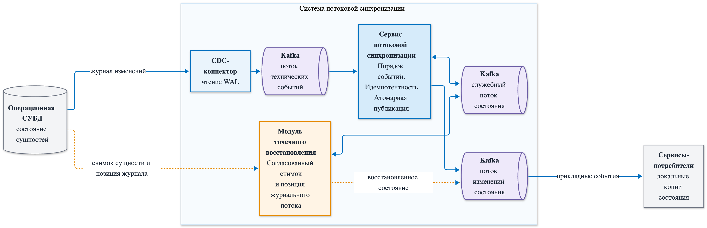

# Stream State Sync

Система потоковой синхронизации состояния для распределённых архитектур. Изменения извлекаются из WAL через CDC, упорядочиваются и атомарно публикуются в Kafka. Сервисы-потребители получают готовый поток прикладных событий и последовательно обновляют своё состояние.

При пропуске событий или сбое система выполняет точечное восстановление. Происходит формирование согласованного снимока сущности, фиксирование позиции в журнале изменений и продолжение публикации с сохранением порядка событий.

## Стек технологий

PostgreSQL и логическая репликация, Debezium, Apache Kafka, Protocol Buffers, Go, Kubernetes, Prometheus и Grafana.

